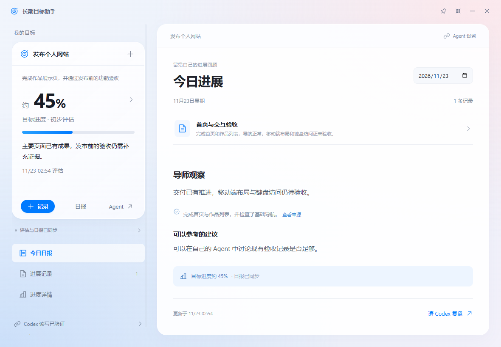

# Goal Companion

[English](README.md) · [简体中文](README.zh-CN.md)

A Windows desktop companion for long-term goals, powered by **your own Codex agent**. Save progress notes and materials locally, discuss them in Codex, and sync evidence-based progress assessments and daily reports back to your desktop.

The repository name reflects the original to-do concept. The current product focuses on goal reflection and progress: it has no built-in chat, automatic daily tasks, or streak-based scoring.



*Actual application screenshot with synthetic test records. The assessment is a test fixture, not a validated measurement of goal achievement.*

## Features

- Light Apple-inspired UI: compact desktop card, daily reports, and progress details.
- User-defined goals with editable criteria and relative weights; templates for projects, training, creative work, life, learning, and custom goals.
- Local text records and file attachments, including backdated entries.
- STDIO MCP tools for Codex to read records and write assessments and reports.
- Evidence references for the actual criteria of each goal, without a fixed learning-only rubric.
- Service-calculated progress, atomic review writes, idempotent receipts, and automatic UI refresh.
- Connection verification, pending/running states, cancellation of result acceptance, and retained previous assessments.
- Tray access and optional always-on-top mode.

The current UI is Simplified Chinese; documentation is available in English and Chinese.

**Platform:** Windows x64. This is an unsigned, early-stage MVP. This initial upload contains source; no prebuilt GitHub Release has been published.

## Quick start

Use **Node.js 24 LTS**. Dependencies require Node.js 22.12 or newer. In PowerShell:

```powershell
git clone https://github.com/RichardF123/How-far-from-now-on---An-AI-to-do-list-tool.git
cd How-far-from-now-on---An-AI-to-do-list-tool
npm ci
npm run setup:electron
npm start
```

`setup:electron` downloads the pinned Windows x64 Electron release from GitHub in chunks, verifies its SHA-256 hash against the checksums supplied with the Electron package, and retains the verified archive for packaging. GitHub release downloads must be reachable.

Choose a goal template, describe your intended outcome, edit the criteria and weights, and confirm. Ongoing goals also require an explicit phase or review scope. Choose **Record** to save a note or attach materials.

## Connect Codex

1. Open **Agent settings** and enable goal archive access. The MVP grants access to **all goals within this app for the current Windows user**; per-direction permissions are not implemented yet.
2. Copy the generated configuration into your Codex MCP settings or configuration file. Keep existing servers and reload the connection as required by your client.
3. In your Codex conversation, ask:

   > Call the learning_mentor verify_connection tool to verify the goal plugin connection.

4. Wait for **Read/write verified** in the app. Save a progress record, choose **Ask Codex to review**, and paste the copied request into Codex. Or ask directly:

   > Read my recent progress records, assess my progress using the agreed criteria, and sync an assessment and today's report to my desktop.

The generated configuration uses the app's Electron runtime in Node mode, so a portable build needs no separate Node.js installation. Copy the configuration again if you move the app folder.

**MCP connectivity does not wake a conversation or schedule model execution.** You initiate reviews in your Codex session. The app does not modify Codex configuration, read its chat database, or import chat history. New tools may require a client reload or a new conversation. See the [Codex MCP documentation](https://developers.openai.com/codex/mcp/).

## How reviews work


Each goal has **1–12 confirmed criteria**, each with its own name, acceptance condition, and positive relative weight. The service normalizes the weights. A project can assess delivery and quality; a creative goal can assess the work and revisions; learning remains one supported template rather than the universal scoring model.

Levels `unknown`, `emerging`, `developing`, and `demonstrated` represent **unverified / started / partially achieved / meets the criterion**, mapping to **0 / 25% / 60% / 100%** satisfaction. The service computes the weighted total; the UI rounds to the nearest five percentage points and labels it approximate. These are coarse product rules, not scientific measurements.

**Outcome goals** assess the agreed result. **Ongoing goals** require a phase or scope, such as a four-week training period: 100% means that phase's standards were met, not that a lifelong habit is permanently complete. The app does not automatically infer a training plan or numerical health targets.

Unknown means **insufficient evidence**, not failure. All-unknown assessments show **Awaiting assessment**, not 0%. References improve traceability but do not guarantee an agent's interpretation. Each review must match the goal's actual criterion IDs; the service rejects a learning-only rubric submitted to a project goal.

New records do not automatically increase progress. A review uses a fixed snapshot; later records remain pending. Duplicate writes return the original receipt. Report-only reviews do not change the last assessment timestamp. Silence and missing records do not automatically lower progress.

## Files and local data

- Up to **10 files per record**, **10 MB per file**.
- Text, Markdown, and supported code formats can be read through the paginated evidence tool.
- Images, PDFs, and unsupported formats are stored but **not parsed**. Add a text explanation if needed.
- Default data location: `%APPDATA%\LearningMentor`, containing `learning.sqlite` and imported `attachments/`.
- `LEARNING_MENTOR_DATA` selects a separate data directory for development or isolated tests.

Records stay local until your authorized Codex agent reads them. Its model provider then processes the material according to that agent's configuration. The desktop app has no built-in model API or cloud sync.

The renderer uses sandboxing, context isolation, a restricted preload API, and CSP. The local adapter uses an authenticated loopback endpoint and a random per-start token stored in a Windows-user-restricted directory, **not yet an OS credential vault**. Do not share runtime connection files or the data directory. Revoking access blocks subsequent MCP calls. This cannot isolate data from administrators or malicious software running as the same Windows user.

## Architecture

```text
React UI → Electron IPC → Local goal core → SQLite snapshot + attachments
                                 ↑
Your Codex → STDIO MCP adapter → Authenticated loopback business endpoint
```

The MVP uses **Electron + React + sql.js**. An earlier design considered Tauri; Electron was selected for this runnable implementation. Business rules are separate from the UI and MCP transport.

sql.js keeps SQLite in memory. Mutations create a candidate database, write and flush a temporary file, then atomically replace the persisted snapshot before publishing results. This suits a small personal archive, not high-volume workloads. Attachment files and database updates are coordinated separately; they are not one cross-filesystem transaction.

| Path | Purpose |
| --- | --- |
| `src/core.cjs` | Records, snapshots, scoring, validation, persistence, receipts |
| `src/mcp.cjs` | MCP tools and agent workflow instructions |
| `src/bridge.cjs` | Authenticated local business endpoint |
| `src/main.cjs`, `src/preload.cjs` | Desktop lifecycle and restricted IPC |
| `src/ui/` | React interface and styles |
| `scripts/` | Build, runtime installation, packaging, desktop verification |
| `test/` | Core and official MCP SDK integration tests |

## Test and package

```powershell
npm test
npm run test:desktop
npm run package
```

Portable output: `release-v0.2/LearningMentor-win32-x64/LearningMentor.exe`. Keep the **entire folder**, not just the executable. Closing the window hides it to the tray; choose **Exit** in the tray menu to stop the service. Title-bar controls provide compact mode and always-on-top.

Tests cover persistence/restart, evidence restrictions, idempotency, cancellation, goal-version conflicts, snapshots, report-only writes, revoked access, and local authorization. The desktop test starts a real Electron window, writes a review through an MCP client while it is running, and checks the refreshed UI. Tests use isolated temporary data.

Screenshots and diagnostic artifacts go to ignored `artifacts/`. Dependencies, build outputs, runtime credentials, SQLite data, and user-imported materials must not be committed.

## Limitations

- Manual review initiation; no scheduled or automatic agent execution.
- Criteria and weights can be edited at creation; existing goals cannot yet be edited, archived, or automatically rolled into a new review period.
- App-wide local authorization; no per-direction grants or remote MCP.
- No PDF extraction, OCR, repository connector, cross-device sync, or built-in chat.
- No automatic backup/restore workflow or signed installer. Exit the app before backing up its complete data directory manually.
- The local core stops when the app exits.

Future work includes assessment calibration, goal version editing, review-period rollover, finer permissions, richer material parsing, and more agent hosts.

## Upgrading from the learning-only MVP

Version 0.2 backs up the version-1 database to `learning.sqlite.before-generic-goals.bak`, then adds explicit criteria to existing goals without changing their scores, records, reports, or weights. The database schema becomes version 2; older apps cannot open it. Exit the previous app before upgrading.

The existing data directory, `LEARNING_MENTOR_DATA`, executable name and MCP registration `learning_mentor` remain unchanged for compatibility. Canonical tools are now `list_goals` and `append_goal_record`; the older `list_learning_goals` and `append_learning_record` remain aliases. Repoint the MCP command to the new portable build and reload it after upgrading.
