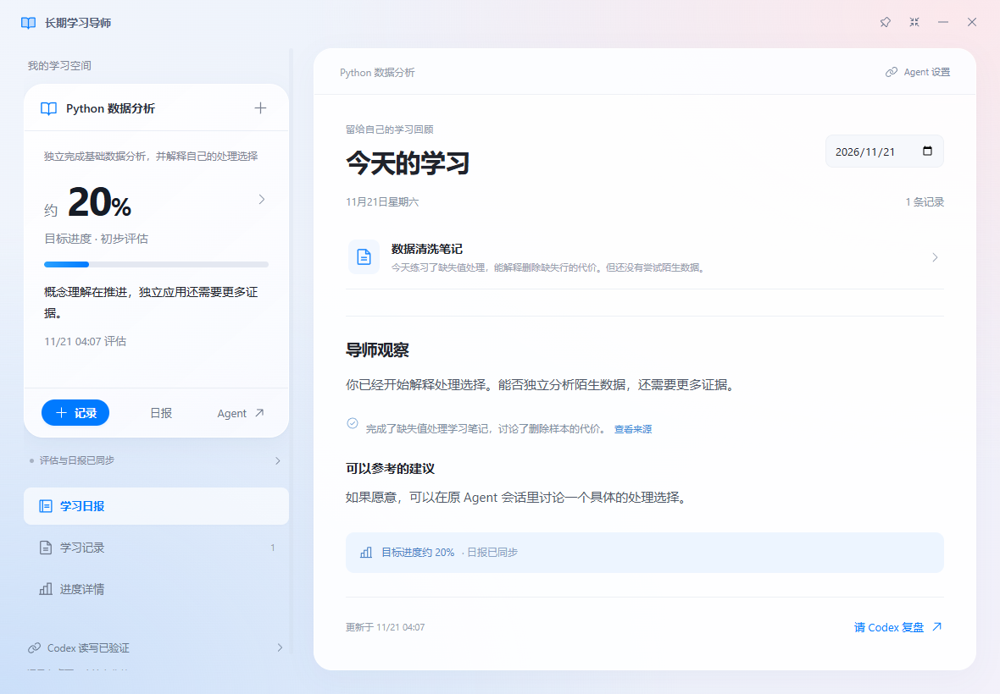
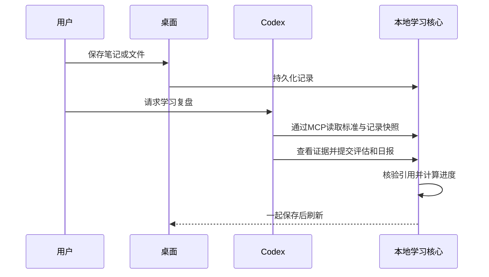

# 长期学习导师

[English](README.md) · [简体中文](README.zh-CN.md)

一个由**用户自己的 Codex Agent** 驱动的 Windows 长期学习桌面工具。把笔记与学习材料保存在本机，在 Codex 中交流，再把有依据的进度评估和学习日报同步回桌面。

仓库名称沿用了早期的待办工具构想；当前定位已调整为长期学习导师，不提供内置聊天、自动每日任务或连续打卡评分。



*实机截图使用隔离测试数据，图中的评估是测试样例，不代表经过验证的真实学习能力测量。*

## 功能

- 浅色 Apple 风格界面，包括紧凑桌面卡片、学习日报和进度详情。
- 创建学习方向，填写期望成果，调整并确认初始评价标准。
- 本地保存文字与文件附件，支持过去日期补记。
- 通过 STDIO MCP 让 Codex 读取记录、写回评估与日报。
- 分别评价内容覆盖、理解程度、独立应用，保留证据来源。
- 本地计算进度，评估与日报一起保存，支持幂等回执及自动刷新。
- 连接验证、等待与执行状态、取消本次结果接收、保留上次评估。
- 托盘入口与可选置顶。

**适用范围：**Windows x64。这是尚未签名的早期最小版本。本次初始上传提供源码，尚未发布预编译 GitHub Release。

## 快速开始

建议使用 **Node.js 24 LTS**，依赖要求 Node.js 22.12 或更新版本。在 PowerShell 中运行：

```powershell
git clone https://github.com/RichardF123/How-far-from-now-on---An-AI-to-do-list-tool.git
cd How-far-from-now-on---An-AI-to-do-list-tool
npm ci
npm run setup:electron
npm start
```

`setup:electron` 从 GitHub 官方发布地址分段下载锁定版本的 Windows x64 Electron，使用 npm 包附带的 SHA-256 校验后安装，并保留归档供打包复用。网络需能访问 GitHub Release 下载。

首次打开后，建立自己的学习方向，描述希望达到的成果，查看并确认三个评价标准。点击「记录」输入内容或选择学习附件。

## 接入自己的 Codex

1. 打开「Agent 设置」，开启学习档案访问。首版授权范围为**当前 Windows 用户在此应用中的全部学习方向**，暂不支持逐方向授权。
2. 将应用生成的配置添加到 Codex 的 MCP 设置或配置文件中，保留已有服务，并按客户端要求重载连接。
3. 在自己的 Codex 会话中发送：

   > 请调用 learning_mentor 的 verify_connection，检查学习插件连接。

4. 应用显示「读写已验证」后，保存学习记录，点击「请 Codex 复盘」，把复制的说明粘贴到 Codex。也可以直接说：

   > 读取我最近的学习记录，按已确认的标准评估进度，生成今天的学习日报并同步到桌面。

生成的配置使用应用自带的 Electron 以 Node 模式运行适配器，便携版无需额外安装 Node.js。移动应用目录后需要重新复制配置。

**连接 MCP 不等于自动唤醒聊天或定时运行模型。**首版由用户在自己的 Codex 会话中发起复盘。应用不会修改 Codex 配置、读取聊天数据库或自动导入历史聊天。新工具可能需要重载客户端或在新会话中才会出现，具体以客户端为准。参见 [Codex MCP 官方文档](https://developers.openai.com/codex/mcp/)。

## 进度与日报如何产生



Codex 按已确认的标准，分别评价**内容覆盖、理解程度、独立应用**。首版权重固定为 **20%、30%、50%**。等级 `unknown`、`emerging`、`developing`、`demonstrated` 对应未验证、初步表现、基本满足、稳定满足，映射为 **0、25%、60%、100%** 的标准满足程度。

服务计算加权总分，界面按五个百分点取整并标注约数。未知表示**证据不足**，不表示用户不会；全部未知时显示「待评估」，不显示 0%。这些是尚未经过教育测量校准的首版产品规则。引用来源提升可追溯性，也不保证 Agent 的解释一定正确。

新增记录不会自动加分。评估使用固定快照，期间新增的记录继续待评估。重复写回返回原回执，不新增评估。仅生成日报时不改变上次评估时间。没有记录或未回应不会自动降低进度。

## 文件与本地数据

- 每条记录最多 **10 个附件**，单个最大 **10MB**。
- 文字、Markdown 和支持的代码格式可通过证据工具分页读取。
- 图片、PDF 和其他不支持的格式会保存，但首版**不解析其内容**，可另补文字说明。
- 默认数据位置：`%APPDATA%\LearningMentor`，包括 `learning.sqlite` 与导入的 `attachments/`。
- 可用 `LEARNING_MENTOR_DATA` 指定开发或隔离测试的数据目录。

记录在本机保存，获授权的 Codex 读取后，其模型提供方会按该 Agent 的配置处理内容。桌面应用没有内置模型 API 或云同步服务。

渲染进程启用 sandbox、上下文隔离、受限 preload API 和 CSP。本地适配器使用回环鉴权接口和每次启动生成的随机令牌。令牌位于当前 Windows 用户独占权限的数据目录中，**暂未使用系统凭据库**。请勿分享运行时连接文件或数据目录。撤销访问会阻止后续 MCP 调用；这层隔离不能抵御管理员或同一 Windows 用户下的恶意程序。

## 技术结构

```text
React 界面 → Electron IPC → 本地学习核心 → SQLite 快照与附件
                                  ↑
用户的 Codex → STDIO MCP 适配器 → 本机回环鉴权业务接口
```

首版采用 **Electron、React、sql.js**。早期方案考虑过 Tauri，本次可运行版本采用 Electron 外壳，业务规则与界面和 MCP 传输分离。

sql.js 在内存中运行 SQLite。修改时生成候选数据库，写入并刷新临时文件，再原子替换持久化快照，成功后才发布结果。适合首版个人规模，暂非大量数据的增量存储方案。附件落盘与数据库更新分别协调，不属于跨文件系统的同一事务。

| 路径 | 职责 |
| --- | --- |
| `src/core.cjs` | 记录、快照、评分、校验、持久化和回执 |
| `src/mcp.cjs` | MCP 工具与 Agent 工作说明 |
| `src/bridge.cjs` | 本地鉴权业务接口 |
| `src/main.cjs`、`src/preload.cjs` | 桌面生命周期与受限 IPC |
| `src/ui/` | React 界面与样式 |
| `scripts/` | 构建、运行时安装、打包及桌面验证 |
| `test/` | 核心和官方 MCP SDK 集成测试 |

## 测试与打包

```powershell
npm test
npm run test:desktop
npm run package
```

便携版输出：`release/LearningMentor-win32-x64/LearningMentor.exe`。请保留**整个文件夹**，不能只复制可执行文件。关闭窗口收起到托盘，右键托盘选择「退出」才停止服务。标题栏提供紧凑卡片与置顶按钮。

测试覆盖持久化与重启、证据限制、幂等、取消、目标版本冲突、快照、仅更新日报、撤销访问和本地接口授权。桌面测试启动真实 Electron 窗口，运行期间通过 MCP 客户端提交评估，检查界面是否刷新。测试使用隔离临时数据，不写入用户档案。

截图与诊断放在已忽略的 `artifacts/`。依赖、构建产物、运行时凭据、SQLite 文件和用户导入材料均不应提交到仓库。

## 当前限制

- 在 Codex 中手动发起复盘，暂不定时或自动运行 Agent。
- 权重固定、初始标准颗粒度较小，暂不支持编辑或归档已有目标。
- 本机应用级授权，暂无按方向授权和远程 MCP。
- 暂无 PDF 提取、OCR、仓库连接、跨设备同步及内置聊天。
- 暂无自动备份恢复与签名安装器。手动备份前请退出应用，并复制完整数据目录。
- 应用退出后本地核心停止运行。

后续包括评价校准、目标版本编辑、更细授权、更多材料解析及更多 Agent 宿主。
